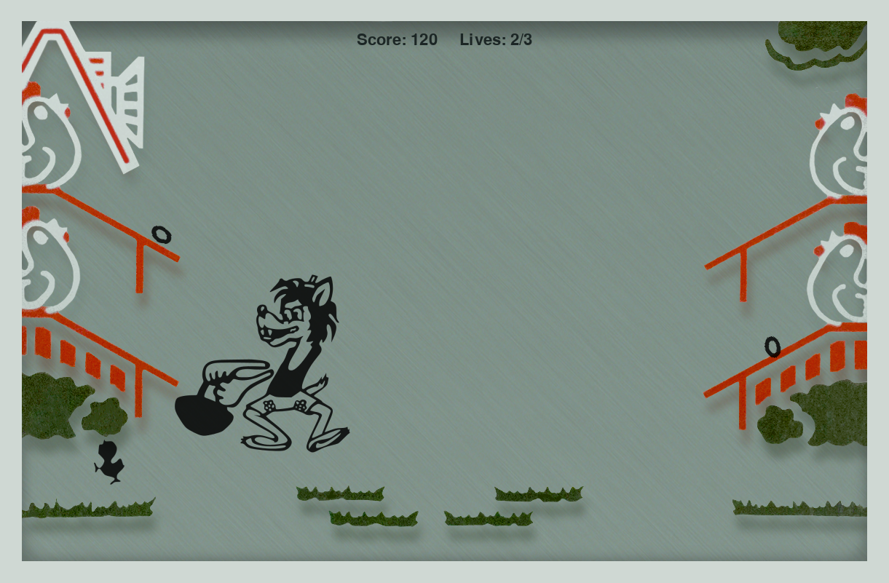

# Ну, погоди!

Небольшая аркадная игра на Python и Pygame. Волк ловит яйца в корзинку: яйца катятся по рельсам, а непойманные падают вниз.

## Скриншот



## Запуск

Нужны Python 3.10 или новее и Pygame.

```bash
python3 -m venv .venv
source .venv/bin/activate
python -m pip install pygame
python main.py
```

В Windows активируйте окружение командой `.venv\Scripts\activate`, затем выполните установку Pygame и запуск игры.

## Управление

| Клавиши | Действие |
| --- | --- |
| `←` / `A`, `→` / `D` | Выбрать сторону |
| `↑` / `W`, `↓` / `S` | Выбрать верхнюю или нижнюю корзинку |
| `P` | Пауза |
| `Enter` / `Space` | Начать игру или начать заново |
| `Esc` | Выйти |

У игрока три жизни. Верхнее яйцо можно поймать верхней корзинкой или направить в нижнюю корзинку на той же стороне. Если яйцо не поймано, оно падает на землю, вылупляется цыплёнок, а игрок теряет жизнь.

## Структура проекта

| Файл | Назначение |
| --- | --- |
| `main.py` | Окно Pygame и главный цикл |
| `config.py` | Размер окна, игрового холста и частота кадров |
| `game.py` | Состояние игры, управление и игровые правила |
| `game_renderer.py` | Подготовка спрайтов и отрисовка сцены |
| `game_assets.py` | Загрузка и сборка игровых ресурсов |
| `svg_sprites.py` | Извлечение спрайтов из SVG |
| `game_entities.py` | Движение яиц и цыплят |
| `game_constants.py` | Координаты сцены и игровые параметры |

Игровые изображения находятся в `assets/`: фоновые слои — `background.png` и `foreground.png`, векторные спрайты — `lcd.svg`.
